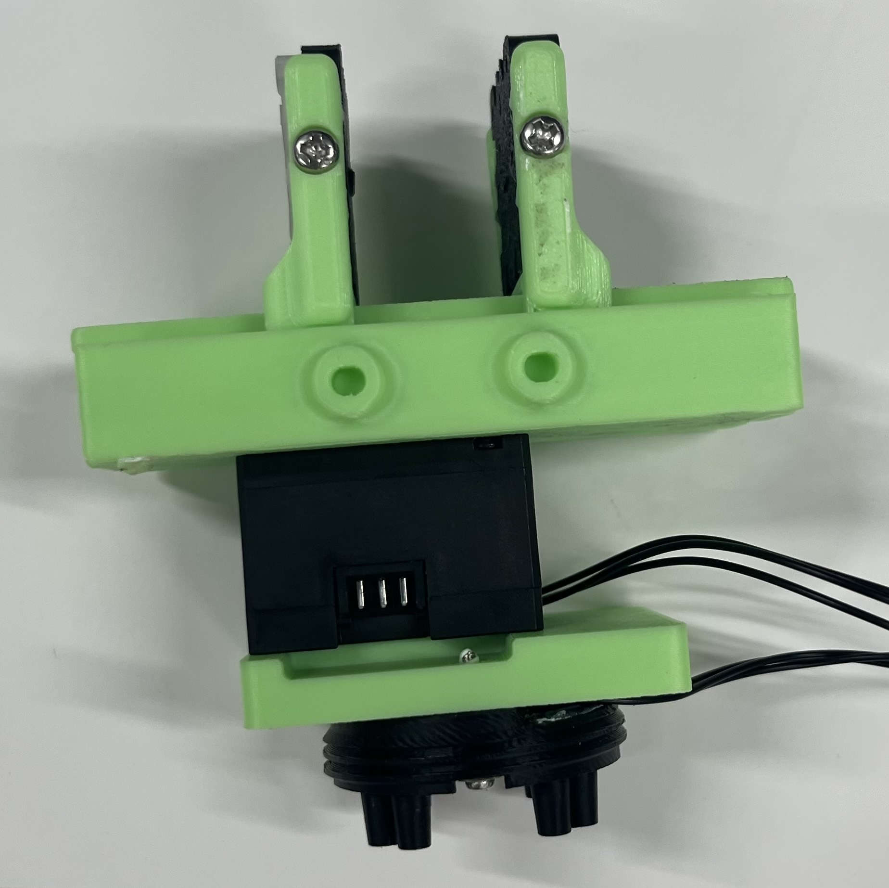
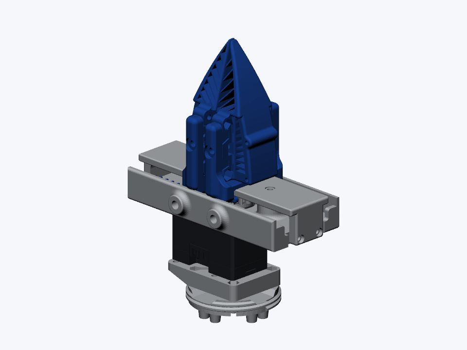
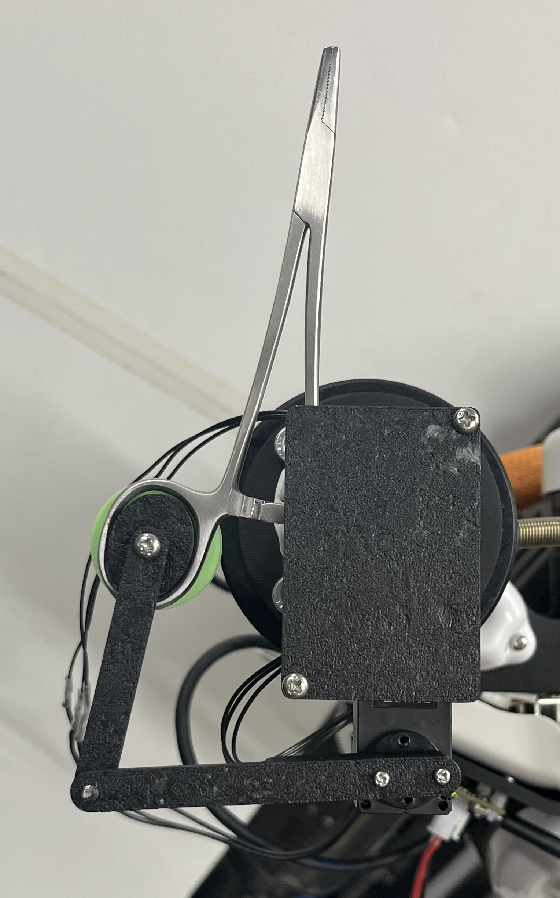
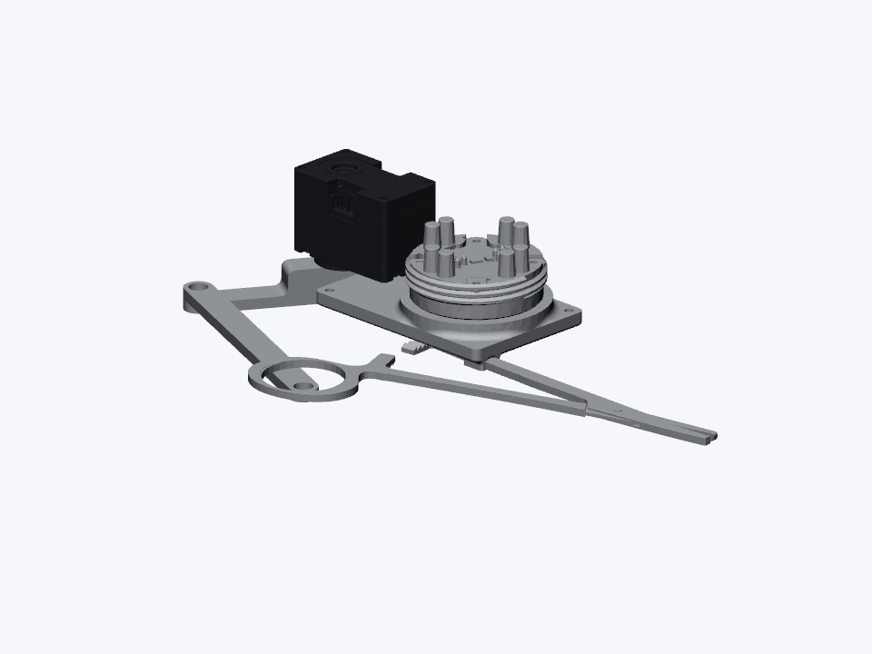
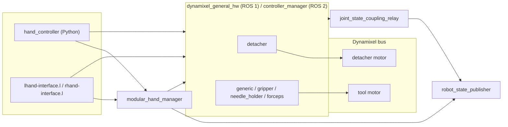

# detachable_tools

Detachable surgical tools (gripper, needle holder, forceps) driven by Dynamixel motors, for ROS 1 and ROS 2.

| Tool | Hardware | Model |
| --- | --- | --- |
| `gripper` |  |  |
| `needle_holder` |  |  |



## Setup

```bash
# ROS 1
cd <catkin workspace>
vcs import src < src/jsk-ros-pkg/jsk_robot/jsk_hand/detachable_tools/ros1.yaml
rosdep install -iry --from-paths src
catkin build detachable_tools

# ROS 2
cd <colcon workspace>
vcs import src < src/jsk-ros-pkg/jsk_robot/jsk_hand/detachable_tools/ros2.yaml
rosdep install -iry --from-paths src
colcon build --packages-up-to detachable_tools
```

To use `/dev/lhand` and `/dev/rhand`:

```bash
sudo scripts/create_udev_rules.sh
sudo udevadm control --reload-rules && sudo udevadm trigger
```

| Motor | Left ID | Right ID |
| --- | ---: | ---: |
| Detacher | 0 | 1 |
| Gripper (`gripper`, `generic`) | 2 | 3 |
| Needle holder (`needle_holder`) | 4 | 5 |
| Forceps (`forceps`) | 6 | 7 |
| YUBI (`yubi`) | 8 | 9 |

YUBI setup, source CAD, and model limitations: [YUBI](meshes/yubi/README.md).

## Usage

Start the hands (the launch files and arguments are the same on ROS 1, `roslaunch ... <name>.launch`):

```bash
ros2 launch detachable_tools hand_control.launch.xml side:=lhand tool:=gripper
ros2 launch detachable_tools dual_hand.launch.xml left_tool:=gripper right_tool:=needle_holder
ros2 launch detachable_tools hand_detacher.launch.xml side:=lhand            # no tool attached
ros2 launch detachable_tools hand_model.launch.xml side:=rhand tool:=needle_holder  # model only
```

### Automatically detect attached tools (ROS 1 / ROS 2)

```bash
ros2 launch detachable_tools dual_hand_auto.launch.xml
# ROS 1
roslaunch detachable_tools dual_hand_auto.launch
```

Automatically detects tools on `/dev/lhand` and `/dev/rhand` at startup.
Stop existing hand launches first. Restart this launch to detect tools again,
or use `set_tool/<tool>` to select a tool at runtime.

- For tool-only hardware, set `include_detacher:=false` (default: `true`).
  If only a tool responds, that side starts with the detacher disabled.
- To change serial settings, use `left_port_name`, `right_port_name`, and `baud_rate`.

### Inspect detected and selected tools

Startup console logs show the arm (`lhand`/left or `rhand`/right), serial port,
responding IDs, tool type, and whether a tool was detected.
Both ROS versions publish `diagnostic_msgs/DiagnosticArray` on:

| Topic (replace `lhand` with `rhand` for the right arm) | Contents |
| --- | --- |
| `/lhand/detected_tool` | Startup scan: side, port, detected IDs, tool, attached, `detection_scope=startup`. Auto launch only. |
| `/lhand/tool_state` | Selected model: side, tool, attached, motor IDs; updated on tool changes. |
| `/lhand/hand_description` | Selected model and individual motor specifications. |

Detection is a startup snapshot, not a live connection or controller-health
monitor. `tool_state` describes the selected model, not proof of successful
motor communication. Check controller_manager for controller/hardware status.
ROS 1 publishers are latched; ROS 2 publishers use reliable transient-local QoS
so late subscribers can retrieve the last message:

```bash
ros2 topic echo /lhand/detected_tool --qos-durability transient_local --qos-reliability reliable --once
ros2 topic echo /rhand/tool_state --qos-durability transient_local --qos-reliability reliable --once
# ROS 1
rostopic echo -n 1 /lhand/detected_tool
rostopic echo -n 1 /rhand/tool_state
```

### Python

```python
from hand_controller import LHandController, RHandController

lhand = LHandController()
lhand.detach()                 # release the tool
lhand.attach()                 # lock the tool
lhand.open()                   # gripper
lhand.close(effort=0.5)        # effort: grasp current [Nm]
lhand.open_holder()            # needle holder
lhand.close_holder()
lhand.open_forceps()           # forceps (also open_scissors / close_scissors)
lhand.close_forceps()
lhand.move_named("open", "needle_holder")  # any <group_state> of srdf/<side>.srdf
```

The open / close positions are the `<group_state>`s of `srdf/lhand.srdf` and `srdf/rhand.srdf`.

Switch the tool without restarting the launch (`generic`, `gripper`, `needle_holder`, `forceps`, `detacher`):

```bash
ros2 service call /lhand/set_tool/needle_holder std_srvs/srv/Trigger
ros2 service call /lhand/get_tool_state std_srvs/srv/Trigger
```

From the command line:

```bash
ros2 run detachable_tools hand_command.py --side lhand close
ros2 run detachable_tools hand_command.py --side lhand detach
```

### EusLisp

The same operations are available from EusLisp:

```lisp
(load "package://detachable_tools/euslisp/all.l")
(lhand-init)
(send *lhand* :close)
(send *lhand* :open-holder)
(send *lhand* :move-named "open" :tool "needle_holder")
(send *lhand* :detach :tm 1.0)
```

`euslisp/tool-change.l` switches the robot model, the IK target and the running hand together:

```lisp
(tool-setup-robot *nextage* :robot-kind :nextage)
(attach-tool *nextage* :rarm :needle-holder :physical t :restart-control t)
(tool-ik *nextage* :rarm target-coords :rotation-axis t)
(detach-tool *nextage* :rarm :physical t :restart-control t)
```

## Add new end-effectors

For a tool named `<tool>` (on both `lhand` and `rhand`):

1. Meshes: put them in `meshes/<tool>/` and refer to them as
   `package://detachable_tools/meshes/<tool>/<file>`.
2. URDF: add `urdf/<side>_<tool>.urdf`, starting from `urdf/<side>_generic.urdf`.
   - The root link is `<side>_base_link` and every name starts with `<side>_`.
   - `<side>_joint` is the tool motor (motor angle in rad, `revolute` with limits wider than
     the SRDF positions), with its `<transmission>` (actuator `<side>_motor`).
   - `<ros2_control name="<side>_<tool>">` has the motor `ID` (unique on the bus) and
     `Operating Mode` (5: current-based position) in `<gpio name="<side>_motor">`;
     rename the `generic/...` service names to `<tool>/...`.
3. SRDF: in `srdf/<side>.srdf`, add `<group name="<side>_<tool>">` with `<side>_joint`
   and its `<group_state>`s (at least `open` and `close`, motor angle in rad).
4. Joints that only follow the motor for display (fingers, linkages): add
   `config/<side>/<tool>_loop_couplings.yaml` (polynomial of `<side>_joint`).
5. ROS 2: in `config/<side>/controllers.yaml`, add `<side>_<tool>` to
   `hardware_components_initial_state.unconfigured` and a `<tool>_gripper_controller`
   (copy an existing one, joint `<side>_<tool>_joint`).

Then `set_tool/<tool>` and `move_named("open", "<tool>")` work for the new tool.

### AprilTag wrist-camera / fork simulation (ROS 2 Jazzy)

ROSだけで動くJSKNextageOpen右腕の運動学デモです。仮想手首カメラの画像を
`apriltag_ros`に入力し、検出TFからfork位置を計算してRVizで脱着を再生します。
scikit-robotは不要です。

```text
仮想カメラ画像 + CameraInfo → apriltag_ros → camera→tag TF
撮影時刻の腕FK + カメラ取付変換 + tag→fork → fork位置推定
→ 全経路IK検証 → JointState / robot_state_publisher / RViz
```

```bash
# 通常の依存導入（既に導入済みなら不要）
sudo apt install ros-jazzy-apriltag-ros python3-scipy python3-opencv
colcon build --packages-select detachable_tools
source install/setup.bash
ros2 run detachable_tools apriltag_fork_sim.py
```

`nextage_tutorials`（`JSKNextageOpenGripper.urdf`とメッシュ）、
`nextage_description`、`robot_state_publisher`、RVizも必要です。
`nextage_tutorials`はこのデモの実行時に必要です。パッケージ全体への依存追加は
循環依存になるため行っていません。既定では
ROS_DOMAIN_ID=87、localhost内に分離し、実機のcontroller/actionは使用しません。
Ctrl-Cで子プロセスも終了します。1回の再生後は画面を保持します。
`--once`は再生後に終了、`--no-rviz --once`は画面なしでの検証です。

この環境で検証したユーザーディレクトリの依存パッケージを使う場合：

```bash
ros2 run detachable_tools apriltag_fork_sim.py \
  --extra-prefix "$HOME/.cache/fork_sim_ros/root/opt/ros/jazzy"
```

`config/fork_simulation.yaml`はメートル・ラジアンです。
既定動作は横から8 cm挿入 → detach → 上へ12 cm抜く → 下げる → attach → 横へ退避。
forkの+Zが上、入口は-Yです。タグは36h11、ID=0、黒枠外周の一辺8 cm。
タグはfork後部のバーの前面に固定し、バーはfork支柱へ接続しています。
手首→グリッパと手首→カメラはJSKモデルの固定ジョイント列から取得します。
標準手先と円柱のダミー工具は使用しません。右グリッパを独立した
robot_state_publisherで表示し、解除後もねじ込み部・力覚センサは腕側に残します。
右腕は観測姿勢から開始し、10枚の認識結果を平均してfork位置を固定します。
画像の時刻に対応するカメラ姿勢で変換し、認識後は全560点のIK、関節範囲、
関節速度、IK解の連続性を検査してから再生します。
`--config FILE`で仮配置と工具支持位置を変更できます。カメラ取付位置はURDFに従います。

`/tmp/apriltag_fork_sim/`に初期カメラ画像、子プロセスログ、完了後の
`report.json`を保存します（`--output`で変更可能）。認識できない場合、
推定誤差が1 cmまたは5度を超える場合、IKが解けない場合は終了します。
真値は画像生成と誤差検証のみに使い、動作目標は検出結果から求めます。

これは理想ピンホールカメラとJSKの実形状ツール／簡略forkによる運動学検証です。
画像はタグ平面を投影したもので、腕・工具による遮蔽、照明、レンズ歪み、
接触力、衝突判定、ロックの機構は模擬していません。detach/attachは
工具が手首に追従するかforkに残るかの状態切替です。ねじの回転・接触は
計算していません。forkの寸法と工具の支持位置は仮設定です。
実機のカメラ外部校正、fork寸法、脱着機構の検証には別途置き換えが必要です。

```bash
PYTHONPATH=src:$PYTHONPATH python3 -m unittest discover -s test -p 'test_fork_simulation.py'
```
