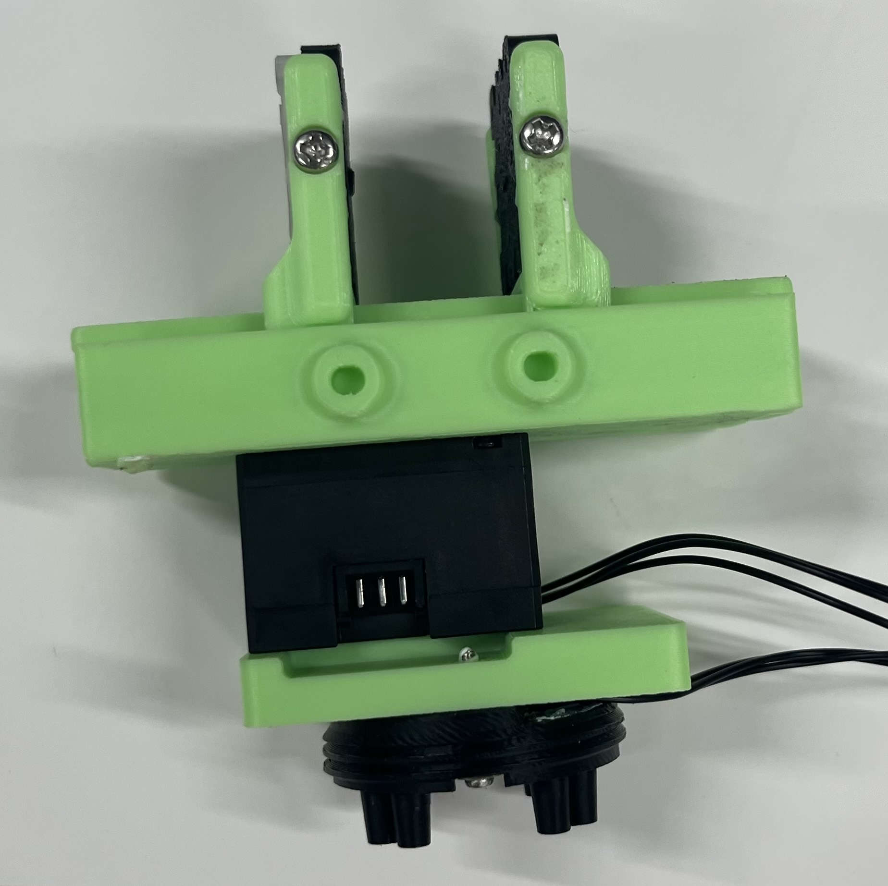
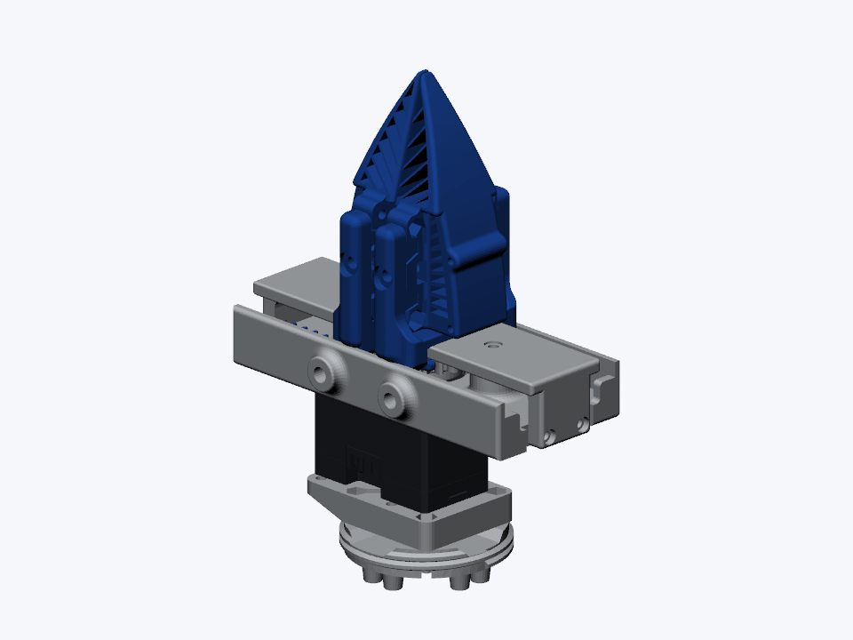
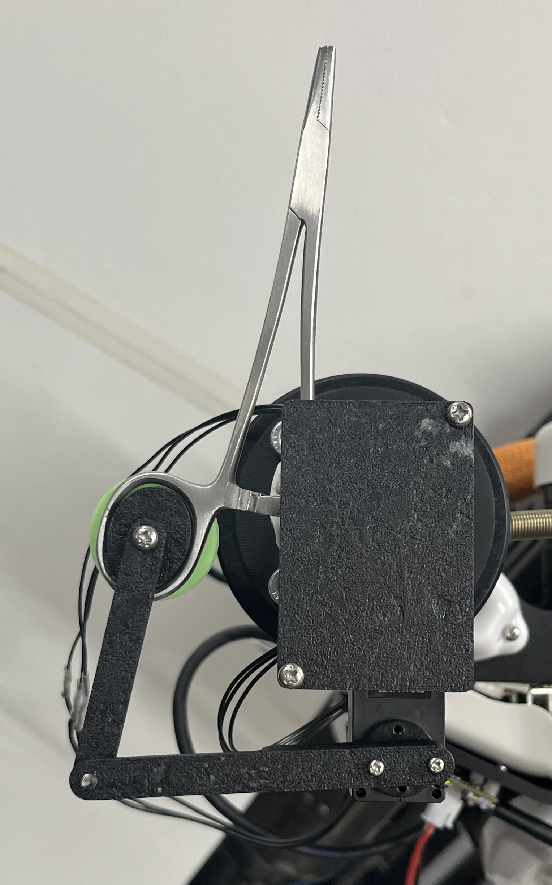
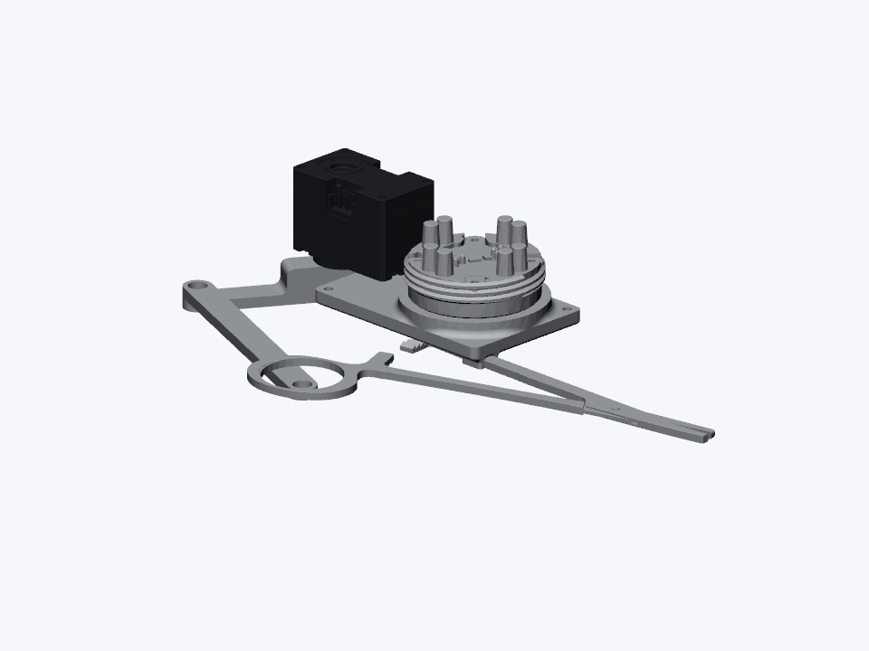
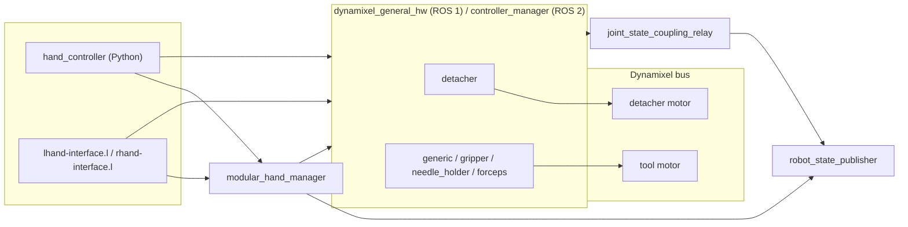

# dynamixel_detachable_hand

Detachable surgical tools (gripper, needle holder, forceps) driven by Dynamixel motors, for ROS 1 and ROS 2.

| Tool | Hardware | Model |
| --- | --- | --- |
| `gripper` |  |  |
| `needle_holder` |  |  |



## Setup

```bash
# ROS 1
cd <catkin workspace>
vcs import src < src/jsk-ros-pkg/jsk_robot/jsk_hand/dynamixel_detachable_hand/ros1.yaml
rosdep install -iry --from-paths src
catkin build dynamixel_detachable_hand

# ROS 2
cd <colcon workspace>
vcs import src < src/jsk-ros-pkg/jsk_robot/jsk_hand/dynamixel_detachable_hand/ros2.yaml
rosdep install -iry --from-paths src
colcon build --packages-up-to dynamixel_detachable_hand
```

To use `/dev/lhand` and `/dev/rhand`:

```bash
sudo scripts/create_udev_rules.sh
sudo udevadm control --reload-rules && sudo udevadm trigger
```

| Motor | Left ID | Right ID |
| --- | ---: | ---: |
| Detacher | 0 | 1 |
| Gripper (`gripper`, `generic`) | 2 | 3 |
| Needle holder (`needle_holder`) | 4 | 5 |
| Forceps (`forceps`) | 6 | 7 |

## Usage

Start the hands (the launch files and arguments are the same on ROS 1, `roslaunch ... <name>.launch`):

```bash
ros2 launch dynamixel_detachable_hand hand_control.launch.xml side:=lhand tool:=gripper
ros2 launch dynamixel_detachable_hand dual_hand.launch.xml left_tool:=gripper right_tool:=needle_holder
ros2 launch dynamixel_detachable_hand hand_detacher.launch.xml side:=lhand            # no tool attached
ros2 launch dynamixel_detachable_hand hand_model.launch.xml side:=rhand tool:=needle_holder  # model only
```

### Python

```python
from hand_controller import LHandController, RHandController

lhand = LHandController()
lhand.detach()                 # release the tool
lhand.attach()                 # lock the tool
lhand.open()                   # gripper
lhand.close(effort=0.5)        # effort: grasp current [Nm]
lhand.open_holder()            # needle holder
lhand.close_holder()
lhand.open_forceps()           # forceps (also open_scissors / close_scissors)
lhand.close_forceps()
lhand.move_named("open", "needle_holder")  # any <group_state> of srdf/<side>.srdf
```

The open / close positions are the `<group_state>`s of `srdf/lhand.srdf` and `srdf/rhand.srdf`.

Switch the tool without restarting the launch (`generic`, `gripper`, `needle_holder`, `forceps`, `detacher`):

```bash
ros2 service call /lhand/set_tool/needle_holder std_srvs/srv/Trigger
ros2 service call /lhand/get_tool_state std_srvs/srv/Trigger
```

From the command line:

```bash
ros2 run dynamixel_detachable_hand hand_command.py --side lhand close
ros2 run dynamixel_detachable_hand hand_command.py --side lhand detach
```

### EusLisp

The same operations are available from EusLisp:

```lisp
(load "package://dynamixel_detachable_hand/euslisp/all.l")
(lhand-init)
(send *lhand* :close)
(send *lhand* :open-holder)
(send *lhand* :move-named "open" :tool "needle_holder")
(send *lhand* :detach :tm 1.0)
```

`euslisp/tool-change.l` switches the robot model, the IK target and the running hand together:

```lisp
(tool-setup-robot *nextage* :robot-kind :nextage)
(attach-tool *nextage* :rarm :needle-holder :physical t :restart-control t)
(tool-ik *nextage* :rarm target-coords :rotation-axis t)
(detach-tool *nextage* :rarm :physical t :restart-control t)
```

## Add new end-effectors

For a tool named `<tool>` (on both `lhand` and `rhand`):

1. Meshes: put them in `meshes/<tool>/` and refer to them as
   `package://dynamixel_detachable_hand/meshes/<tool>/<file>`.
2. URDF: add `urdf/<side>_<tool>.urdf`, starting from `urdf/<side>_generic.urdf`.
   - The root link is `<side>_base_link` and every name starts with `<side>_`.
   - `<side>_joint` is the tool motor (motor angle in rad, `revolute` with limits wider than
     the SRDF positions), with its `<transmission>` (actuator `<side>_motor`).
   - `<ros2_control name="<side>_<tool>">` has the motor `ID` (unique on the bus) and
     `Operating Mode` (5: current-based position) in `<gpio name="<side>_motor">`;
     rename the `generic/...` service names to `<tool>/...`.
3. SRDF: in `srdf/<side>.srdf`, add `<group name="<side>_<tool>">` with `<side>_joint`
   and its `<group_state>`s (at least `open` and `close`, motor angle in rad).
4. Joints that only follow the motor for display (fingers, linkages): add
   `config/<side>/<tool>_loop_couplings.yaml` (polynomial of `<side>_joint`).
5. ROS 2: in `config/<side>/controllers.yaml`, add `<side>_<tool>` to
   `hardware_components_initial_state.unconfigured` and a `<tool>_gripper_controller`
   (copy an existing one, joint `<side>_<tool>_joint`).

Then `set_tool/<tool>` and `move_named("open", "<tool>")` work for the new tool.
